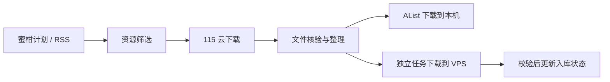

# Mikan115

自托管动漫资源管理与自动追番工具，集成蜜柑计划、115 网盘及 AList，提供动漫检索、RSS 订阅、云端转存、文件命名和下载管理。

## 功能特性

- **动漫目录**：支持季度浏览、搜索、作品详情及 Bangumi、TMDB 元数据同步。
- **云端转存**：选择蜜柑计划资源或提交磁力链接，通过 115 云下载保存，关联作品按 `mikan/系列名/剧集文件` 整理。
- **RSS 追番**：支持作品、字幕组及个人 MyBangumi 订阅，可按字幕版本、分辨率、集数和关键词筛选资源。
- **智能去重**：支持字幕组优先级、候选等待、资源去重及任务状态跟踪。
- **文件命名**：支持自动改名、季集编号、配套字幕命名及可选的 Sonarr 集号校对，115 与 VPS 使用相同的系列目录结构。
- **下载与入库**　可通过 AList 下载到本机，或另建任务下载到 VPS。详情页支持补集、全集收录和按偏好洗版。
- **账号管理**：支持本地管理员与普通账号，凭据加密存储，云盘任务目录隔离。

## 快速开始

### 环境要求

- Git
- Python 3.12+
- Docker 与 Docker Compose v2
- 可用的 115 网盘账号及受支持的第三方客户端 Cookie（用于转存）

### Docker Compose

```bash
git clone https://github.com/yywyao/anime-115.git
cd anime-115
python3 tools/start.py
```

启动命令自动准备私有配置，启动网站、AList 和 Sonarr。已有配置会保留。

查看服务状态可运行以下命令。

```bash
docker compose ps
docker compose logs -f app
```

打开网站 `http://127.0.0.1:8788`。AList 和 Sonarr 使用同一部署的私有网络，地址及认证信息自动配置。远程服务器可通过 SSH 端口转发访问网站。

```bash
ssh -L 8788:127.0.0.1:8788 user@server
```

使用域名部署时，可参考 [Caddy 配置示例](deploy/Caddyfile.example)，启用 HTTPS 并在 `.env` 中设置 `MIKAN_SECURE_COOKIE=1`，随后执行 `docker compose up -d`。请勿直接对公网开放 AList 管理端口。

### 初始化

1. 打开 Mikan115，使用 `.env` 中的 `MIKAN_SETUP_TOKEN` 创建管理员账号。
2. 在设置中粘贴一次已有的 115 第三方客户端 Cookie，应用会验证会话并自动挂载 AList 的 115 存储。
3. 按需填写 TMDB API。AList 和 Sonarr 默认使用自动配置，也可在设置中切换「自定义」并随时恢复自动配置。 [使用与维护指南](docs/usage.md)
4. 浏览动漫资源，创建转存任务或 RSS 订阅。

## 工作流程



在详情页打开「转存至 115」，筛选并选择资源后，可分别点击「转存至 115」或「下载到 VPS」。下载到 VPS 会在转存、改名和整理就绪后通过 AList 自动下载，任务独立跟踪。默认追番规则处理订阅后发布的资源，可按需启用历史资源处理。

## 配置

| 配置项 | 用途 |
| --- | --- |
| `MIKAN_PORT` | Web 服务端口，默认 8788 |
| `MIKAN_SECURE_COOKIE` | HTTPS 部署时设置为 1 |
| `MIKAN_URL` | 蜜柑计划服务地址 |
| `MIKAN_SETUP_TOKEN` | 首次管理员初始化令牌 |
| `ALIST_PASSWORD` | 自动生成的本机服务部署凭据 |

115 Cookie、TMDB 凭据及自定义服务凭据通过管理员设置加密保存。自动模式会获取 AList 管理令牌并配置 Sonarr API Key。完整配置模板参见 [`.env.example`](.env.example)。

## 更新与备份

更新前备份 `runtime/app` 和私有 `.env`，数据库与配套加密密钥应一并保留。VPS 下载文件位于 `runtime/app/library/mikan/系列名`。

```bash
git pull --ff-only
docker compose up -d --build
```

## 文档

- [使用与维护指南](docs/usage.md)：订阅规则、文件命名、第三方服务、原生运行及测试。
- [目录数据来源与署名](NOTICE-Catalog-Data.md)

## 相关项目

- [蜜柑计划](https://mikanani.me/)
- [AList](https://github.com/AlistGo/alist)
- [Bangumi](https://bangumi.tv/)
- [TMDB](https://www.themoviedb.org/)
- [Sonarr](https://sonarr.tv/)
- [AutoBangumi](https://www.autobangumi.org/)

本项目使用 TMDB 数据，但未经 TMDB 认可或认证。第三方组件及数据的许可与署名参见 [目录数据声明](NOTICE-Catalog-Data.md) 和 [React 许可声明](NOTICE-React-MIT.txt)。

## 问题反馈

功能建议和问题请通过 [GitHub Issues](https://github.com/yywyao/anime-115/issues) 提交。反馈时请附上复现步骤及脱敏日志。

请遵守相关服务条款，仅处理有权使用的资源。实际云下载能力取决于 115 账号权限、配额和第三方服务可用性。
