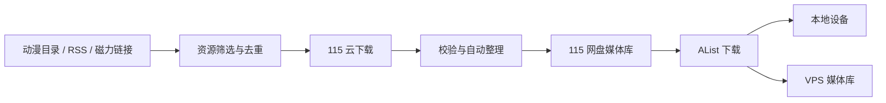

# Mikan115

**面向 115 网盘的自托管动漫订阅、转存与媒体库管理工具。**

Mikan115 集成多源 RSS、115 云下载、AList 和 Sonarr，提供从动漫检索、资源筛选到自动追番、文件整理及服务器入库的完整工作流。

[快速开始](#快速开始) · [使用指南](docs/usage.md) · [问题反馈](https://github.com/yywyao/anime-115/issues)

## 功能特性

| 功能 | 说明 |
| --- | --- |
| 动漫目录 | 季度浏览、作品搜索、Bangumi 与 TMDB 元数据同步 |
| 多源追番 | 支持蜜柑计划、动漫花园、Nyaa、ACG.RIP 的 RSS 订阅 |
| 资源筛选 | 字幕组优先级、字幕版本、分辨率、集数及关键词过滤，支持跨来源去重 |
| 云端转存 | 115 云下载、批量磁力导入、任务管理与文件校验 |
| 媒体库管理 | 支持 115 网盘与 VPS 独立入库、缺集补全、全集收录和版本升级 |
| 自动整理 | 标准化季集命名、配套字幕整理、系列目录归档与 Sonarr 集号校对 |
| 系统管理 | 多用户权限、凭据加密存储、增量更新与启动失败回滚 |

## 工作流程



115 和 VPS 分别维护库存及任务状态。已有云端资源可直接复用于 VPS 入库，无需重复转存。

## 快速开始

### 环境要求

- Git、Python 3.12+
- Docker 与 Docker Compose v2
- 可用的 115 网盘账号及受支持的第三方客户端 Cookie（云下载功能）

### 部署

```bash
git clone https://github.com/yywyao/anime-115.git
cd anime-115
python3 tools/start.py
```

启动脚本自动生成私有配置，并启动 Mikan115、AList 和 Sonarr。已有配置将保留。

默认访问地址：**http://127.0.0.1:8788**

远程服务器可通过 SSH 转发访问：

```bash
ssh -L 8788:127.0.0.1:8788 user@server
```

使用域名访问时，参考 [Caddy 配置](deploy/Caddyfile.example) 启用 HTTPS，将 `.env` 中的 `MIKAN_SECURE_COOKIE` 设置为 `1`，再执行 `docker compose up -d`。默认 AList 和 Sonarr 仅在容器内部网络提供服务。

### 初始化

1. 使用 `.env` 中的 `MIKAN_SETUP_TOKEN` 创建管理员账号。
2. 在设置中绑定 115 第三方客户端 Cookie。
3. 按需配置 TMDB API，或接入自定义 AList、Sonarr 服务。
4. 创建转存任务或 RSS 订阅。

## 配置

| 环境变量 | 说明 |
| --- | --- |
| `MIKAN_PORT` | Web 服务端口，默认 `8788` |
| `MIKAN_URL` | 蜜柑计划服务地址 |
| `MIKAN_SECURE_COOKIE` | HTTPS 部署时设为 `1` |
| `MIKAN_SETUP_TOKEN` | 管理员初始化令牌 |
| `ALIST_PASSWORD` | 自动生成的内部服务凭据 |

完整模板见 [`.env.example`](.env.example)。115 Cookie、TMDB API 及自定义服务凭据通过管理员设置管理，请妥善保护私有配置。

## 媒体库

115 网盘与 VPS 使用统一的系列目录结构：

```text
mikan/
└── 系列名/
    ├── 系列名 - S01E01 [字幕组] [简日] [1080p].mkv
    └── 系列名 - S02E01 [字幕组] [简日] [1080p].mkv
```

VPS 媒体库位于 `runtime/app/library/mikan/`。资源整理、下载和入库均经过校验，避免覆盖已有文件。

## 更新与维护

管理员可在「设置 → 系统更新」检查并应用增量更新。支持自动更新、版本回滚，保留账号、配置及媒体文件；自动应用默认关闭。

基础镜像、AList、Sonarr 及部署配置更新使用：

```bash
git pull --ff-only
docker compose up -d --build
```

查看运行状态与日志：

```bash
docker compose ps
docker compose logs -f app
```

更新前请备份 `runtime/app` 和私有 `.env`，数据库与配套加密密钥应一并保留。

## 文档与支持

- [使用与维护指南](docs/usage.md)：资源管理、RSS 规则、文件命名、第三方服务及高级配置。
- [目录数据来源与署名](NOTICE-Catalog-Data.md)
- [GitHub Issues](https://github.com/yywyao/anime-115/issues)：功能建议与问题反馈，请附上复现步骤和脱敏日志。

## 致谢

[蜜柑计划](https://mikanani.me/) · [AList](https://github.com/AlistGo/alist) · [Bangumi](https://bangumi.tv/) · [TMDB](https://www.themoviedb.org/) · [Sonarr](https://sonarr.tv/) · [AutoBangumi](https://www.autobangumi.org/)

本项目使用 TMDB 数据，但未经 TMDB 认可或认证。第三方组件及数据的许可与署名见 [数据声明](NOTICE-Catalog-Data.md) 和 [React 许可声明](NOTICE-React-MIT.txt)。

请遵守相关服务条款，仅处理有权使用的资源。云下载能力取决于账号权限、配额及第三方服务的可用性。
