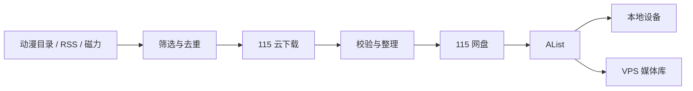

# Mikan115

**面向 115 网盘的自托管动漫自动化管理工具。**

集成多源 RSS、115 云下载、AList 与 Sonarr，实现自动追番、资源筛选、文件整理及云端与 VPS 媒体库管理。

[快速开始](#快速开始) · [使用指南](docs/usage.md) · [问题反馈](https://github.com/yywyao/anime-115/issues)

## 功能特性

| 功能 | 说明 |
| --- | --- |
| 动漫目录 | 季度浏览、作品搜索、Bangumi 与 TMDB 元数据同步 |
| 自动追番 | 支持蜜柑计划、动漫花园、Nyaa、ACG.RIP 的 RSS 订阅 |
| 资源筛选 | 字幕组优先级、字幕版本、分辨率、集数与关键词筛选，支持跨来源去重 |
| 云端转存 | 115 云下载、批量磁力导入、独立任务管理与文件校验 |
| 媒体库管理 | 115 与 VPS 独立库存、缺集补全、全集收录与版本升级 |
| 文件整理 | 标准化季集命名、字幕整理、系列归档及 Sonarr 集号校对 |
| 存储配置 | 自定义 115 转存目录、目录迁移与重名保护 |
| 系统管理 | 本地账号与权限、凭据加密、增量更新及兼容版本回滚 |

## 快速开始

### 环境要求

- Git、Python 3.12+
- Docker 与 Docker Compose v2
- 115 网盘账号及受支持的第三方客户端 Cookie（云下载功能）

### 部署

```bash
git clone https://github.com/yywyao/anime-115.git
cd anime-115
python3 tools/start.py
```

启动脚本自动初始化私有配置，并启动 Mikan115、AList 和 Sonarr；已有配置将保留。

默认访问地址：**http://127.0.0.1:8788**

远程部署可通过 SSH 转发访问：

```bash
ssh -L 8788:127.0.0.1:8788 user@server
```

使用域名时，参考 [Caddy 配置](deploy/Caddyfile.example) 启用 HTTPS，将 `.env` 中的 `MIKAN_SECURE_COOKIE` 设置为 `1`，再执行 `docker compose up -d`。默认 AList 和 Sonarr 仅在容器内部网络提供服务。

### 初始化

1. 使用私有 `.env` 中的 `MIKAN_SETUP_TOKEN` 创建管理员账号。
2. 在设置中验证 115 Cookie，保存转存目录（默认 `anime`）。
3. 按需配置 TMDB API 或自定义 AList、Sonarr 服务。
4. 创建转存任务或 RSS 订阅。

## 工作流程



云端与 VPS 分别核对库存，已有云端文件可直接复用于 VPS 入库。

## 存储与配置

默认媒体目录按系列归档：

```text
anime/
└── 系列名/
    ├── 系列名 - S01E01 [字幕组] [简日] [1080p].mkv
    └── 系列名 - S02E01 [字幕组] [简日] [1080p].mkv
```

- **115 网盘**：根目录名称可在设置中修改。
- **VPS**：默认路径为 `runtime/app/library/anime/`。

旧版 `mikan` 目录支持迁移，并保留已有文件和任务记录；遇到同名目录冲突时停止操作。详见 [存储目录与迁移](docs/usage.md#存储目录与迁移)。

| 环境变量 | 说明 |
| --- | --- |
| `MIKAN_PORT` | Web 服务端口，默认 `8788` |
| `MIKAN_URL` | 蜜柑计划服务地址 |
| `MIKAN_SECURE_COOKIE` | HTTPS 部署时设为 `1` |
| `MIKAN_SETUP_TOKEN` | 管理员初始化令牌 |
| `ALIST_PASSWORD` | 自动生成的内部服务凭据 |

完整配置见 [`.env.example`](.env.example)。第三方服务凭据通过管理员设置管理，请妥善保护私有配置。

## 更新与维护

在「设置 → 系统更新」检查并应用增量更新，支持自动更新和兼容版本回滚。自动应用默认关闭。

基础镜像、依赖服务及 Compose 配置更新：

```bash
git pull --ff-only
docker compose up -d --build
```

查看服务状态：

```bash
docker compose ps
docker compose logs -f app
```

更新前请备份 `runtime/app` 与私有 `.env`，并保留数据库及配套加密密钥。目录迁移后仅支持回滚至兼容 `anime` 布局的版本。

## 文档与支持

- [使用与维护指南](docs/usage.md)
- [目录数据来源与署名](NOTICE-Catalog-Data.md)
- [GitHub Issues](https://github.com/yywyao/anime-115/issues)：提交问题时请附复现步骤及脱敏日志。

## 致谢

[蜜柑计划](https://mikanani.me/) · [AList](https://github.com/AlistGo/alist) · [Bangumi](https://bangumi.tv/) · [TMDB](https://www.themoviedb.org/) · [Sonarr](https://sonarr.tv/) · [AutoBangumi](https://www.autobangumi.org/)

本项目使用 TMDB 数据，但未经 TMDB 认可或认证。第三方许可及署名见 [数据声明](NOTICE-Catalog-Data.md) 与 [React 许可声明](NOTICE-React-MIT.txt)。

请遵守相关服务条款，仅处理有权使用的资源。云下载能力取决于账号权限、配额及第三方服务可用性。
